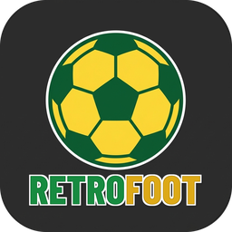

<p align="center">
  <br><br>
  
</p>

Jogo de gestão de futebol inspirado no jogo clássico dos anos 90. Você treina um clube,
escala o time, compra e vende jogadores, cuida do dinheiro e do estádio e disputa
campeonato e copa, temporada após temporada, sozinho ou com outros treinadores humanos no
mesmo computador.

O RetroFoot é livre e de código aberto, escrito em C# com [Avalonia](https://avaloniaui.net/).
Roda no Linux, no Windows e (em desenvolvimento) no Android.

<p align="center">
  
</p>

## Download

> **Versão beta:** espere bugs e coisas por melhorar. Encontrou um problema? Abra uma
> [issue](https://github.com/juan-silveira/RetroFoot/issues).

| Sistema | |
|---|---|
| 🐧 Linux (x64) | [Baixar v0.1.1 beta](https://github.com/juan-silveira/RetroFoot/releases/download/v0.1.1-beta/retrofoot-0.1.1-beta-linux-x64.tar.gz) |
| 🪟 Windows (x64) | [Baixar v0.1.1 beta](https://github.com/juan-silveira/RetroFoot/releases/download/v0.1.1-beta/retrofoot-0.1.1-beta-windows-x64.zip) |
| 🍎 macOS | em breve... |
| 🤖 Android | em breve... |

Todas as versões ficam em [Releases](https://github.com/juan-silveira/RetroFoot/releases).
A partir da 0.1.1 o jogo avisa ao abrir quando sai uma versão nova e se atualiza sozinho
(Linux e Windows); seus saves e configurações ficam como estão.

## Destaques

- **Dois visuais:** o **Retrô**, com a cara das janelas do Windows 95, e o **Moderno**,
  com o tema verde e amarelo. A tela pode ser 4:3 ou 16:9.
- **Duas versões de regras:** a **Retrô**, igual ao jogo clássico, e a **Atual**, com
  5 substituições, banco maior, acréscimos, cartões amarelos e outras novidades
  (Configurações > Regras).
- **Hub de ferramentas:** Editor de Equipas (com escudos), Editor de Save, Scout, Patches
  e Árbitros, tudo dentro do jogo.
- **Dados abertos:** equipas em JSON (uma por arquivo), países e árbitros em TSV, logos em
  PNG. Patches no formato do jogo clássico (`.EFT`, `.TXE`, zip ou pasta) são convertidos
  sozinhos.
- **Português do Brasil, português de Portugal, inglês e espanhol.**

## Como compilar e jogar

Precisa do [.NET SDK](https://dotnet.microsoft.com/download) 8 ou mais novo (o Android
precisa do .NET 10 com a workload `android`).

```sh
git clone https://github.com/juan-silveira/RetroFoot.git
cd RetroFoot
dotnet run --project RetroFoot.Desktop
```

### Gerar o executável

Um arquivo só, com o runtime junto (detalhes em [docs/build.md](docs/build.md)):

```sh
dotnet publish RetroFoot.Desktop -c Release -r linux-x64 -o dist/linux
dotnet publish RetroFoot.Desktop -c Release -r win-x64   -o dist/windows
```

No Linux, `scripts/instalar-linux.sh` publica e instala para o usuário (sem sudo), com
atalho no menu e o comando `retrofoot`.

### Onde ficam os dados

O jogo guarda equipas, saves, logos e configurações na pasta `data`, ao lado do
executável (modo portátil: dá para levar num pendrive). Se ali não der para gravar, usa a
pasta do sistema (`~/.local/share/retrofoot` ou `%LOCALAPPDATA%\retrofoot`). O caminho
aparece no hub, com o botão **Abrir pasta de dados**. Formatos em
[docs/ferramentas.md](docs/ferramentas.md).

## Estrutura

| Pasta | O que tem |
|---|---|
| `RetroFoot.Motor` | O motor do jogo, em C# puro e sem interface: partidas, mercado, temporada, saves e arquivos de dados |
| `RetroFoot.App` | As telas (Avalonia), iguais em todas as plataformas, e os assets |
| `RetroFoot.Desktop` | O executável para Linux, Windows e macOS |
| `RetroFoot.Android` | O app Android (em desenvolvimento) |
| `RetroFoot.Motor.Testes` | Os testes do motor (xUnit) |
| `ferramentas/` | Conversor da pasta de dados e o teste de resistência da interface (SoakUI) |
| `docs/` | Notas de projeto: build, pasta de dados, regras, idiomas, tema |

### Testes

```sh
dotnet test RetroFoot.Motor.Testes
```

Parte dos testes compara o motor, byte a byte, com saves gravados pelo jogo clássico.
Esses saves não estão no repositório; sem eles, esses testes falham.

## Licença

O código do RetroFoot está sob a [GNU GPL v3](LICENSE): você pode usar, estudar, modificar
e redistribuir, desde que as versões distribuídas continuem abertas sob a mesma licença.

Nomes, escudos e marcas de clubes, ligas e patrocinadores pertencem aos seus donos e
aparecem só como referência. As fontes Liberation estão sob a SIL Open Font License.
